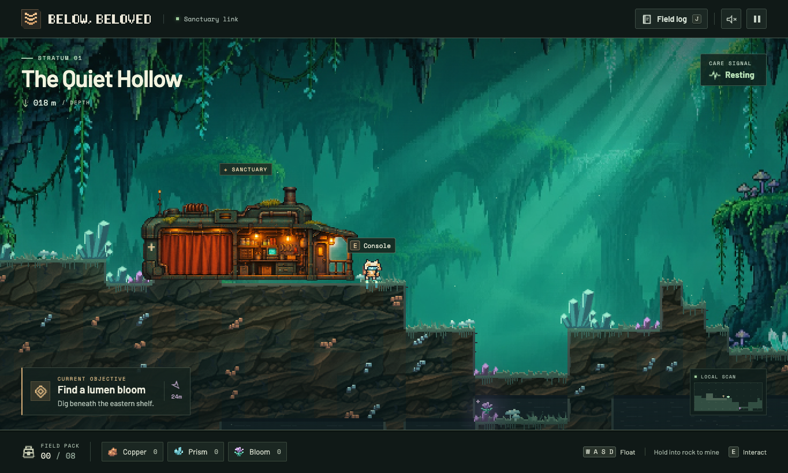

# Below, Beloved — development status

**Playable vertical slice complete.** Verified on November 23, 2026. The production build starts in the sanctuary and remains playable after the care revelation.

## Milestones

| Chunk | Delivered | Milestone gate |
| --- | --- | --- |
| 1. Movement and excavation | Four-direction float, held-contact strikes, collision, durability, camera, keyboard and directional pad | Typecheck, 4 tests and build passed. A real-time Chrome keyboard smoke check changed the canvas during sustained excavation. |
| 2. Cave and exploration | Seeded finite world, two minerals, persistent drops, reserved specimen slot, sanctuary and sealed medical annex | Typecheck, 8 tests and build passed. Reachability checked across 80 seeds. |
| 3. Research and care | Two observations, three hypotheses, safe retries, breathing treatment, recurring care, linked revelation and optional pack extension | Typecheck, 14 tests and build passed. Three complete simulation journeys used movement and interactions from spawn. |
| 4. Feel and release | Local pixel art, impact debris and durability feedback, warm sanctuary, audio, focus management, pause, local scan and portrait controls | Clean install, typecheck, 19 tests, static build and production-preview browser journeys passed. |

## Release verification

| Check | Actual result |
| --- | --- |
| Environment | Node 24.14.1, npm 11.11.0, Vite 7.3.8 and Vitest 5.1.1. Exact packages are in the lockfile. |
| npm ci | Passed. npm reported zero known vulnerabilities during installation. |
| npm run dev | Served the game locally. |
| npm run typecheck | Passed under strict TypeScript. |
| npm run test | All 19 tests in four files passed. |
| npm run build | Produced static HTML, bundled JS and CSS, fonts and art in dist/. JS measured 83.92 kB gzip and CSS 3.81 kB gzip. |
| npm run preview | Served the production build on port 4173. The short-portrait asset check recorded successful same-origin requests and no page errors. |
| Chrome 157, desktop 1365 × 820 | Completed the full loop with keyboard movement and held E. Checked both minerals, specimen pickup, panel opening, return, wrong hypothesis feedback, correct treatment, care response and restart on seed 42. |
| Chrome 157, emulated touch 390 × 844 | Completed the same loop using touch events on the direction pad, hold action and console buttons. Inspected a 2× pixel-density portrait rendering. |
| Chrome 157, short portrait 320 × 568 | Inspected the layout and checked horizontal overflow, touch cancellation during mining, pause/resume, the blur handler, field log, invalid seed rejection, reduced-motion preference and mute/unmute. |
| Playwright WebKit 27.2, desktop 1365 × 820 | Completed the keyboard journey through the built preview, including sample recovery, an incorrect inference, the revelation and seed restart. |

The browser journeys sent normal input to the game. They used controlled browser time for reproducible hold durations and checked visible inventory, prompts, objectives and care responses. No game-state injection was used. The full-loop simulation cases cover seeds 0, 1703 and 4294967295. The generation sweep covers seeds 0 through 79.

## Implemented tuning and scope

- The finite region is 72 × 43 tiles. An authored entry shelf and sample pocket lead toward a seeded annex location. Mineable terrain connects both ends, and opened tunnels persist.
- The simulation advances at 60 Hz. Float speed is 3.65 tiles per second. Strikes repeat every 200 ms and the annex needs a 700 ms uninterrupted hold.
- Eight pack slots include one reserved specimen pocket. Two copper buy two additional mineral slots. Inventory tests cover a full pack, persistent drops and purchases using both stored and carried copper.
- Care reaches “Needs care” after 115 active seconds and stays there until treated. Tests exercised prolonged neglect, repeated care and the alternate order in which the player treats before finding the annex. The living culture remains available after treatment.
- Progress is session-only. Restart accepts an unsigned 32-bit seed. All assets ship with the static build.
- The cavern panorama, sanctuary and shale texture are generated raster art. The android, material deposits, flora, annex equipment, local scan and effects are drawn in code. The privacy curtain stays closed.

## Verification limits

Physical phone ergonomics, iOS Safari, Android Chrome on hardware, Firefox and subjective audio playback remain untested. WebKit verification used the Playwright desktop engine. Browser audio checks covered unlocking and mute state. No live Vercel deployment or long-session hardware performance benchmark was performed.
